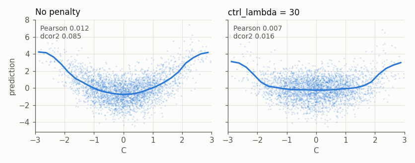

# Decorrelation penalty

`ctrl_lambda` penalises the dependence between a model's predictions and one or more control
variables. The inputs are:

- `X`: the input features;
- `Y`: the target;
- `C`: a control variable whose dependence with the predictions should be reduced. `C` may or may
  not be one of the features.

Dependence is measured by distance covariance, which also captures nonlinear dependence. The
[design notes](../dcov-design.md) describe how the penalty is defined and computed.

## Data

`Y` depends on `C` only through its square. `C` is not a feature, but the first feature is a noisy
measurement of it, so a model can learn that dependence. `Y0` is the part of `Y` that does not
depend on `C`. Rows come in groups of 200, identified by `group`.

```julia
using EvoTrees, Random, Statistics, Printf

function simulate(rng; ngroups=200, group_size=200)
    n = ngroups * group_size
    group = repeat(1:ngroups, inner=group_size)
    c = randn(rng, n)
    x = hcat(c .+ 0.2 .* randn(rng, n), randn(rng, n, 3))
    y0 = x[:, 2] .+ 0.5 .* x[:, 3] .+ 0.5 .* x[:, 4]
    y = y0 .+ 0.8 .* (c .^ 2 .- 1) .+ 0.5 .* randn(rng, n)
    return (; x, y, y0, c, group)
end

rng = Xoshiro(1)
train, valid, test = simulate(rng), simulate(rng), simulate(rng)
```

## Fitting with the penalty

Pass the control as `ctrl_train`, one value per row, or from a table as the column name
`ctrl_name`. That column is not used as a feature unless listed in `feature_names`.

```julia
config(λ) = EvoTreeRegressor(loss=:mse, nrounds=200, eta=0.05, max_depth=5, ctrl_lambda=λ)

m0 = EvoTrees.fit(config(0.0); x_train=train.x, y_train=train.y, verbosity=0)
m1 = EvoTrees.fit(config(30.0); x_train=train.x, y_train=train.y, ctrl_train=train.c, verbosity=0)
```

On the test set, compare the Pearson correlation and the squared distance correlation
(`EvoTrees.dcor2`) of the predictions with `C`, and their correlation with `Y` and `Y0`:

```julia
for (name, m) in (("no penalty", m0), ("ctrl_lambda = 30", m1))
    p = m(test.x)
    @printf("%-16s  cor(p, C) %.3f  dcor2(p, C) %.3f  cor(p, Y) %.3f  cor(p, Y0) %.3f\n", name,
        cor(p, test.c), EvoTrees.dcor2(p, test.c), cor(p, test.y), cor(p, test.y0))
end
```

```
no penalty        cor(p, C) 0.012  dcor2(p, C) 0.085  cor(p, Y) 0.926  cor(p, Y0) 0.754
ctrl_lambda = 30  cor(p, C) 0.007  dcor2(p, C) 0.016  cor(p, Y) 0.860  cor(p, Y0) 0.902
```



Without the penalty the predictions follow the square of `C` (left), yet their Pearson correlation
with `C` is near zero. The distance correlation captures this dependence, and the penalty removes
most of it. The predictions then track `Y0` more closely and `Y` less, since part of `Y` comes from
`C`.

## Within groups

To remove the dependence within each group only, set `ctrl_within_group = true` and pass the group
ids. The control is then standardised and the penalty computed within each group.

```julia
config_g = EvoTreeRegressor(loss=:mse, nrounds=200, eta=0.05, max_depth=5,
    ctrl_lambda=30.0, ctrl_within_group=true)
m2 = EvoTrees.fit(config_g; x_train=train.x, y_train=train.y, ctrl_train=train.c,
    group_train=train.group, verbosity=0)

rows = [findall(==(g), test.group) for g in unique(test.group)]
for (name, m) in (("no penalty", m0), ("within groups", m2))
    p = m(test.x)
    @printf("%-14s  mean dcor2(p, C) within groups %.3f\n", name,
        mean(EvoTrees.dcor2(p[r], test.c[r]) for r in rows))
end
```

```
no penalty      mean dcor2(p, C) within groups 0.084
within groups   mean dcor2(p, C) within groups 0.016
```

The groups here have no structure of their own, so the result is close to the pooled fit. The two
forms differ when `C` or `Y` has a group-level component, which only the pooled penalty acts on.

## Choosing `ctrl_lambda`

Fit a few weights and compare them on validation data. The error rises as the dependence falls:

```julia
for λ in (0.0, 3.0, 10.0, 30.0, 100.0, 300.0)
    m = EvoTrees.fit(config(λ); x_train=train.x, y_train=train.y, ctrl_train=train.c, verbosity=0)
    p = m(valid.x)
    @printf("ctrl_lambda %5g  mse %.3f  cor(p, C) %+.3f  dcor2(p, C) %.4f\n", λ,
        mean((p .- valid.y) .^ 2), cor(p, valid.c), EvoTrees.dcor2(p, valid.c))
end
```

```
ctrl_lambda     0  mse 0.430  cor(p, C) -0.000  dcor2(p, C) 0.0833
ctrl_lambda     3  mse 0.450  cor(p, C) -0.002  dcor2(p, C) 0.0640
ctrl_lambda    10  mse 0.556  cor(p, C) -0.003  dcor2(p, C) 0.0382
ctrl_lambda    30  mse 0.805  cor(p, C) -0.004  dcor2(p, C) 0.0147
ctrl_lambda   100  mse 1.151  cor(p, C) -0.003  dcor2(p, C) 0.0035
ctrl_lambda   300  mse 4.265  cor(p, C) +0.159  dcor2(p, C) 0.0229
```

Past some `ctrl_lambda * eta`, between 5 and 15 here, the fit oscillates instead of settling, as at
300, so a larger weight needs a smaller `eta`. The weight also scales with the target: a target 10
times larger needs about 10 times the weight.

## Several controls

`ctrl_train` also takes a matrix with one column per control, and `ctrl_name` a vector of names.
Each control adds its own term, multiplied by its entry in `ctrl_weights`. Here the fourth feature
is added as a second control with half the weight:

```julia
m3 = EvoTrees.fit(config(30.0); x_train=train.x, y_train=train.y,
    ctrl_train=hcat(train.c, train.x[:, 4]), ctrl_weights=[1.0, 0.5], verbosity=0)

for (name, m) in (("no penalty", m0), ("C", m1), ("C and X4", m3))
    p = m(test.x)
    @printf("%-10s  dcor2(p, C) %.3f  dcor2(p, X4) %.3f\n", name,
        EvoTrees.dcor2(p, test.c), EvoTrees.dcor2(p, test.x[:, 4]))
end
```

```
no penalty  dcor2(p, C) 0.085  dcor2(p, X4) 0.088
C           dcor2(p, C) 0.016  dcor2(p, X4) 0.124
C and X4    dcor2(p, C) 0.017  dcor2(p, X4) 0.006
```

Penalising `C` alone makes the model lean more on the fourth feature, and the second control limits
that. Since the terms are summed, a dependence that shows only in a combination of controls is not
penalised.

## Early stopping

With evaluation data, the loss's own metric includes the penalty, so early stopping follows the
penalised objective. The evaluation data needs the same controls (`ctrl_eval`, or the `ctrl_name`
columns in `deval`), and its groups under `ctrl_within_group`.

```julia
config_es = EvoTreeRegressor(loss=:mse, nrounds=2000, eta=0.05, max_depth=5,
    ctrl_lambda=30.0, early_stopping_rounds=50)
m4 = EvoTrees.fit(config_es; x_train=train.x, y_train=train.y, ctrl_train=train.c,
    x_eval=valid.x, y_eval=valid.y, ctrl_eval=valid.c, verbosity=0)

logger = m4.info[:logger]
i = logger[:best_iter] + 1
@printf("best round %d: mse %.4f, dependence %.5f, penalised %.4f\n", logger[:best_iter],
    logger[:base_metrics][i], logger[:ctrl_dependence][i][1], logger[:metrics][i])
```

```
best round 281: mse 0.8030, dependence 0.00793, penalised 1.0408
```

The penalised value is the mse plus `ctrl_lambda` times the dependence, `dcov2` of the predictions
and the standardised control. The logger keeps both parts for every round under `:base_metrics` and
`:ctrl_dependence`. Other metrics, such as `:mae`, are reported unchanged.

## Other losses and devices

The penalty is available on `EvoTreeRegressor` for `:mse`, `:logloss`, `:poisson`, `:gamma` and
`:tweedie`, and on `EvoTreeMLE` for `:gaussian_mle`, where it acts on the location. Under losses
other than `:mse` its gradient is weighted by the loss's curvature, so a given weight has about the
same effect. On GPU the penalty is computed on the host. The MLJ interface cannot pass controls, so
the penalty is only available through `EvoTrees.fit`.
